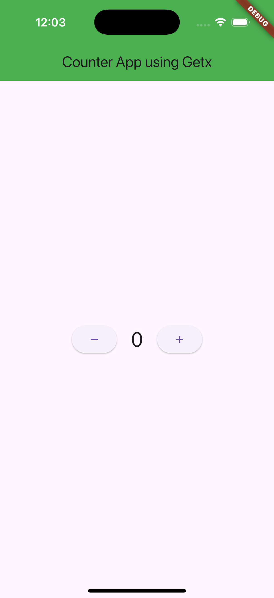

# Flutter Counter App QA Report

**Date:** 2026-10-24  
**Project:** `/Users/rafi/StudioProjects/flutter_batch_two_assignment`  
**Target:** iPhone 16 Pro simulator, iOS 18.2  
**Bundle ID:** `com.example.flutterBatchTwoAssignment`

## Summary

- **Confirmed application bugs:** 0
- **Passed UI regression flows:** 0
- **Blocked UI regression flows:** 4
- **Application test failures:** 0 observed

No application bug was confirmed. Maestro could not execute any flow because it reported the booted simulator unreachable during `deviceInfo`. The folder run reports `total_commands_executed: 0`; those blocked runs do not establish whether the app passes or fails the interactions.

## Device and screen inspection

Maestro initially inspected the iPhone 16 Pro screen and returned the app title, counter value `0`, and bounds for the decrement and increment controls. The controls did not expose accessibility labels, so the saved flows use screen points verified against those inspected bounds:

- Decrement: center of `[105,472][171,520]` → `138,496`
- Increment: center of `[230,472][296,520]` → `263,496`

The simulator was also confirmed booted with `xcrun simctl list devices booted`. A PNG diagnostic capture shows the normal initial screen and counter value `0`; it is **not bug evidence** and is not presented as such:

## Regression flow results

| Flow | Expected check | Result | Evidence / reason |
|---|---|---|---|
| `.maestro/counter_increment.yaml` | Starts at 0; tapping increment shows 1 | **Blocked** | Maestro: `Device became unreachable during deviceInfo`; no commands executed |
| `.maestro/counter_decrement.yaml` | Starts at 0; tapping decrement shows -1 | **Blocked** | Maestro folder run: same device error; no commands executed |
| `.maestro/counter_regression.yaml` | 0 → 1 → 2 → 1 | **Blocked** | Individual and folder runs: same device error; no commands executed |
| `.maestro/smoke.yaml` | App title is visible | **Blocked** | Maestro folder run: same device error; no commands executed |

The Maestro MCP folder run enumerated all four flows and returned `success: false`, `total_commands_executed: 0`, and the device error for each. This is an **environment/device connectivity issue**, not an app failure or YAML syntax failure. All four flow files also parsed successfully with Ruby's YAML parser. Because the Maestro commands never started, there are no failed app screens to capture, and Maestro did not produce execution screenshots or a detailed HTML run report. A separate HTML status report is saved at [qa-artifacts/maestro-run-report.html](qa-artifacts/maestro-run-report.html).

## Bug log

**Zero confirmed bugs.** No mismatch between expected and actual counter behavior could be reproduced because Maestro could not interact with the simulator. No `BUG-*.png` files are claimed as evidence. The diagnostic PNG above is only the normal screen observed before test execution.

## Reproduction steps prepared in saved flows

- **Increment:** launch with cleared app state → verify `0` → tap inspected increment point → expect `1`.
- **Decrement:** launch with cleared app state → verify `0` → tap inspected decrement point → expect `-1`.
- **Regression:** launch with cleared app state → verify `0` → tap increment twice, checking `1` and `2` → tap decrement, checking `1`.

These are the intended test steps in the YAML files, not completed interactions; the Maestro device error prevented their execution.
